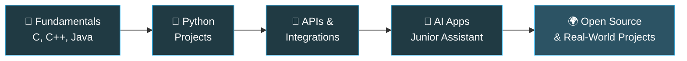

<div align="center">


<br/>

<a href="https://github.com/TheSrajanJain"></a>
<a href="https://thesrajanjain.github.io/Portfolio/"></a>
<a href="https://www.instagram.com/the_srajanjain/"></a>
<a href="mailto:thesrajanjain@gmail.com"></a>

<br/><br/>


</div>

---

## 👨‍💻 About Me

```python
class Srajan:
    def __init__(self):
        self.role      = "Developer from India 🇮🇳"
        self.focus     = ["Junior (AI voice assistant)", "AI-powered apps"]
        self.learning  = ["Python", "API integration", "Software design fundamentals"]
        self.interests = ["Automation", "Web apps", "Developer tools", "Business utilities"]
        self.approach  = "Build it → Test it → Break it → Learn → Improve"
        self.goal      = "Build a career in the coding field 🚀"

    def say_hi(self):
        return "Let's build something useful together!"
```

I like taking an idea from a rough concept to a working project, learning by experimenting, and improving my code with every bug I fix.

<table>
<tr>
<td width="50%">

### 🔭 Currently
- 🤖 Building **Junior**, my Python AI voice assistant
- 🌱 Learning **Python, APIs & backend basics**
- 🧪 Experimenting with **AI integrations**

</td>
<td width="50%">

### 🎯 Next Up
- 📦 Better docs and setup guides for every repo
- 🔌 More real-world API projects
- 🌍 First open-source contributions

</td>
</tr>
</table>

---

## 🚀 Featured Projects

<div align="center">

<a href="https://github.com/TheSrajanJain/Junior-AI">
  
</a>
<a href="https://github.com/TheSrajanJain/Python-Programming">
  
</a>

<a href="https://github.com/TheSrajanJain/MySQL-Database">
  
</a>
<a href="https://github.com/TheSrajanJain/Java-By-Srajan-Jain">
  
</a>

</div>

### 📂 All Projects

| | Project | Description | Links |
|:-:|---|---|:-:|
| 🤖 | **Personal AI ChatBot** | A personal chatbot project inspired by conversational AI. | [🌐 Live Demo](https://thesrajanjain.github.io/Personal-AI-ChatBot/) |
| 🎙️ | **Junior AI Assistant** | A Python-based voice assistant that I'm actively developing. | [💻 Source](https://github.com/TheSrajanJain/Junior-AI) |
| 🌐 | **My Portfolio** | A home for my projects and developer profile. | [🌐 Visit](https://thesrajanjain.github.io/Portfolio/) |
| ☕ | **Java By Srajan Jain** | Java examples and beginner-friendly practice. | [💻 Explore](https://github.com/TheSrajanJain/Java-By-Srajan-Jain) |
| 🐍 | **Python Programming** | Python code, exercises, and mini projects. | [💻 Explore](https://github.com/TheSrajanJain/Python-Programming) |
| ⚙️ | **C Programming** | C examples and logic-building practice. | [💻 Explore](https://github.com/TheSrajanJain/C-Programming-By-Srajan-Jain) |
| 🧩 | **C++ Programming** | C++ and object-oriented programming practice. | [💻 Explore](https://github.com/TheSrajanJain/Cpp-Programming-by-Srajan-Jain) |
| 🎨 | **HTML & CSS** | Frontend experiments and web-design practice. | [💻 Explore](https://github.com/TheSrajanJain/HTML-and-CSS-by-Srajan-Jain) |
| 🗄️ | **MySQL Database** | SQL notes, worksheets, and cheat sheets. | [💻 Explore](https://github.com/TheSrajanJain/MySQL-Database) |

> 💬 Have an idea or suggestion for a project? Open an issue or reach out. I'd love to hear it.

---

## 🛠️ Tech Stack

<div align="center">

**Languages**


**Tools & Platforms**


</div>

<details>
<summary><b>🔍 Areas I'm exploring (click to expand)</b></summary>
<br/>

| Area | What I'm doing |
|---|---|
| 🤖 **AI Integrations** | Connecting AI models to real applications |
| 🔌 **APIs** | Consuming and integrating third-party APIs |
| ⚙️ **Backend** | Learning server-side fundamentals |
| 🗄️ **Databases** | Writing and structuring SQL |
| 🎨 **UI Design** | Prototyping interfaces and clean layouts |
| 🔁 **Automation** | Scripting repetitive tasks away |

</details>

<sub>*Icons show my interests, tools, and learning areas, not a claim of professional mastery in every technology.*</sub>

---

## 📊 GitHub Stats

<div align="center">


</div>

<details>
<summary><b>🏆 Trophies (click to expand)</b></summary>
<br/>
<div align="center">

</div>
</details>

---

## 🗺️ My Learning Roadmap



---

## 🧭 What I'm Working Toward

- [ ] 🤖 Improve **Junior**, my Python AI assistant
- [ ] 🧼 Write cleaner, more maintainable code
- [ ] 🔌 Get better at API integration and working with data
- [ ] 🧠 Strengthen problem-solving and software-design fundamentals
- [ ] 📝 Publish every project with clear docs and setup instructions
- [ ] 🌍 Contribute to open-source projects
- [x] 🌱 Build a solid base in Python, Java, C, C++, HTML/CSS and MySQL

---

## 💪 Daily Dev Loop

<div align="center">

| 🧠 Think | 🛠️ Build | 🧪 Test | 🐞 Debug | 🔁 Improve |
|:-:|:-:|:-:|:-:|:-:|
| Plan the idea | Write the code | Try to break it | Learn from bugs | Refactor & ship |

</div>

---

## 📚 Learning Resources

<details>
<summary><b>Docs and practice sites I use (click to expand)</b></summary>
<br/>

| Resource | Link |
|---|---|
| 🐍 Python Docs | [docs.python.org](https://docs.python.org/3/) |
| 🌐 MDN Web Docs | [developer.mozilla.org](https://developer.mozilla.org/) |
| ☕ Java Docs | [docs.oracle.com/en/java](https://docs.oracle.com/en/java/) |
| 🗄️ MySQL Docs | [dev.mysql.com/doc](https://dev.mysql.com/doc/) |
| 🎓 freeCodeCamp | [freecodecamp.org](https://www.freecodecamp.org/) |
| 📘 GeeksforGeeks | [geeksforgeeks.org](https://www.geeksforgeeks.org/) |
| 🐙 GitHub Docs | [docs.github.com](https://docs.github.com/) |
| 🤖 OpenAI Platform | [platform.openai.com/docs](https://platform.openai.com/docs) |

</details>

---

## 🤝 Let's Connect

I'm happy to connect with fellow developers, exchange ideas, discuss projects, and learn from the community.

<div align="center">

<a href="https://github.com/TheSrajanJain"></a>
<a href="https://thesrajanjain.github.io/Portfolio/"></a>
<a href="https://www.instagram.com/the_srajanjain/"></a>
<a href="mailto:thesrajanjain@gmail.com"></a>

<br/><br/>


<br/>

### 💡 Build with curiosity. Improve with consistency.

<sub>© Srajan Jain · Made with curiosity and code ⭐ If something here interests you, check out the repositories!</sub>


</div>
